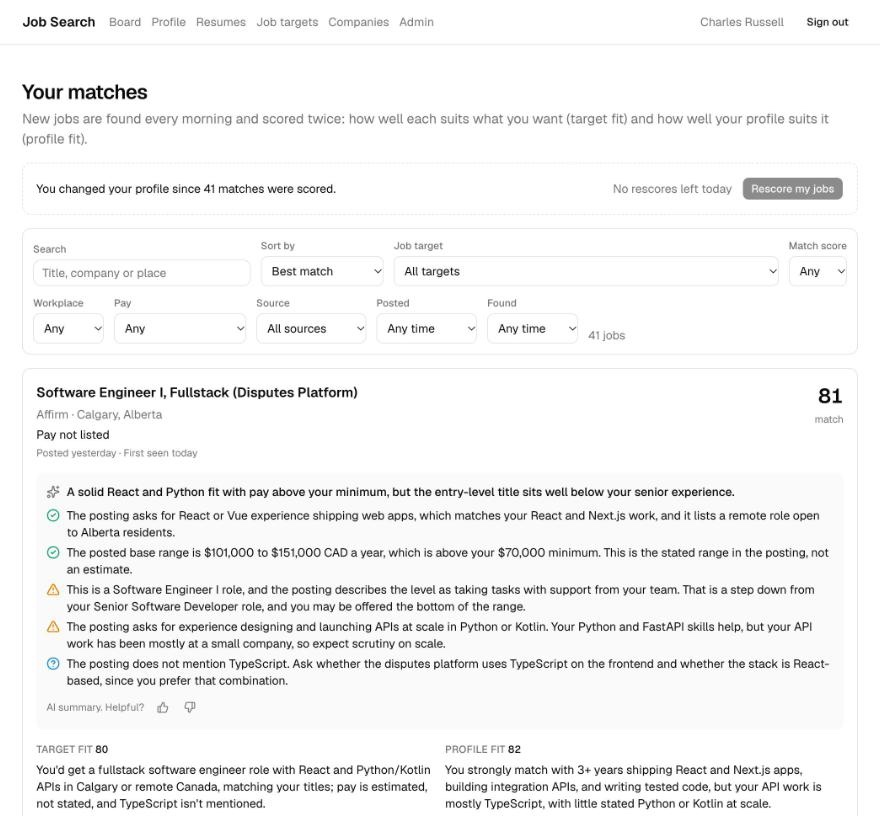
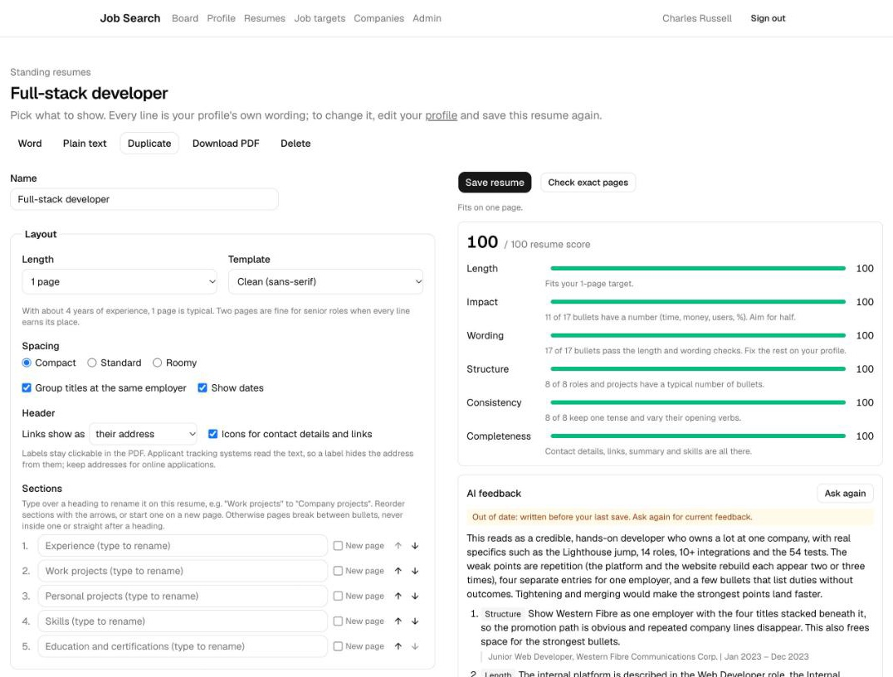
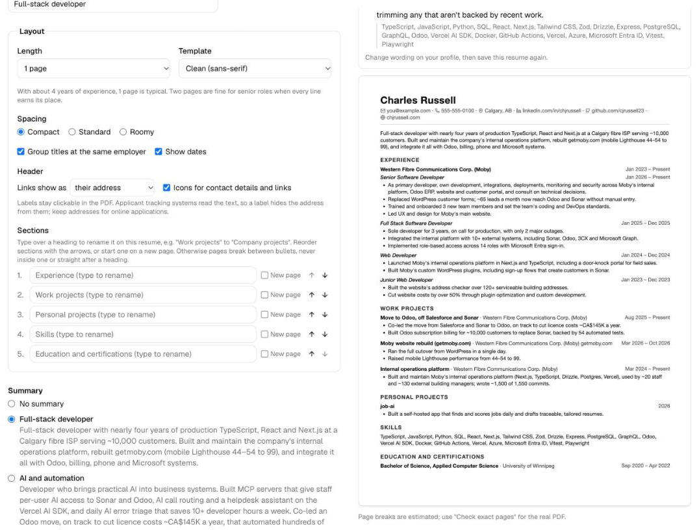
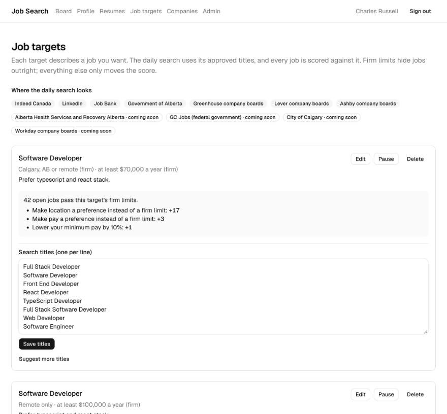
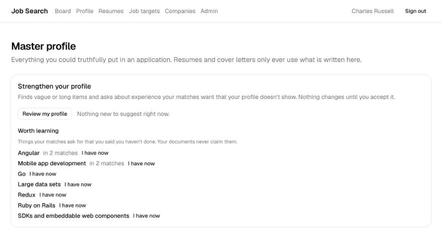
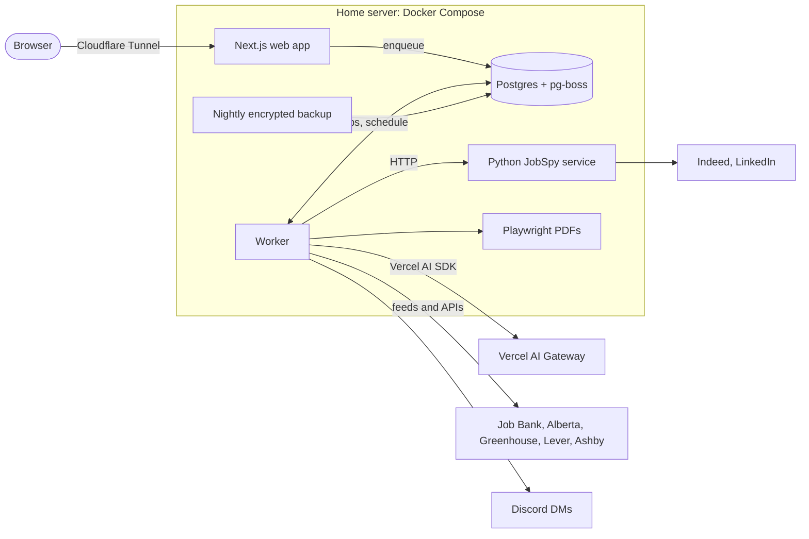

# Job Search

A self-hosted, invite-only web app that finds jobs every morning, scores each one against what you want and what you've done, and drafts tailored resumes and cover letters from your own master profile, never from invented facts.

I built it for myself and a handful of people job hunting in and around Calgary. It runs on my home server at [jobs.chjrussell.com](https://jobs.chjrussell.com), which is invite-only.



## What it does

- **Finds jobs daily.** Each morning the worker searches Indeed, LinkedIn, Canada's Job Bank, the Government of Alberta and the Greenhouse, Lever and Ashby boards of watched companies. The same role advertised on three sites becomes one job with three postings, so it is shown and scored once.
- **Scores every match twice.** *Target fit* is how well the job suits what you want: title, place, pay, workplace. *Profile fit* is how well your profile suits the job. You see both, each with a readable reason and a list of pros and cons, instead of one opaque number.
- **Applies firm limits before any AI.** A job outside a firm limit, say pay below your minimum, is filtered out before a model is ever called. A field the posting doesn't state counts as "unknown", never as a fail.
- **Never invents facts.** Resumes and cover letters are built only from the master profile. The AI may select, reorder and rephrase profile items, never add to them, and every generated line records which profile items it came from. When something seems missing, the app asks you rather than guessing, and a "no" is passed to the model as something not to claim.
- **Builds resumes you can check.** A resume builder with live preview, a 0–100 score (length, impact, wording, structure, consistency, completeness), AI feedback, and PDF and Word export.
- **Tracks applications** on a board from saved to outcome. Nothing is sent to an employer without your action, and an application can only use documents you've approved.
- **Is invite-only.** Google sign-in for addresses the admin has invited; no passwords, no email service. Each member's profile, documents and applications are private, including from the admin.

| Resume builder and score | Resume preview |
| --- | --- |
|  |  |

| Job targets and firm limits | Master profile |
| --- | --- |
|  |  |

## Architecture



- **Web app:** Next.js (App Router, TypeScript), Tailwind and shadcn/ui. Server components for reads, server actions for writes, no separate REST API. The web app only enqueues work.
- **Worker:** the same TypeScript package with a different entry point. It runs everything long-running: the daily run, sources, scoring, drafting, PDF rendering and notifications.
- **Database:** Postgres through Drizzle. It also backs the job queue and daily schedule (pg-boss), so there is no Redis.
- **AI:** the Vercel AI SDK through the Vercel AI Gateway. Every model call is a named task behind one wrapper that reads the model from admin settings, checks the member's spend cap, records usage and cost, and validates the output with Zod before anything is saved.
- **Sources:** every job source sits behind one TypeScript interface, so a broken one can be swapped without touching the rest. Indeed and LinkedIn go through a thin Python service wrapping [JobSpy](https://github.com/speedyapply/JobSpy), with no database access and no business logic.
- **PDFs:** rendered by Playwright from HTML templates; Word export via `docx`.
- **Deployment:** Docker Compose on a home server, reached through a Cloudflare Tunnel with no open router ports. GitHub Actions runs type checks, lint and tests on every pull request and publishes images to GitHub's container registry; migrations run when the web container starts.

## Rules the code holds to

1. **No invented facts.** The master profile is the only source for resumes and cover letters, and every generated line is traced to profile items. The one allowed guess is a pay estimate, always labelled and never counted as stated pay ([ADR 0002](docs/adr/0002-pay-estimates-are-allowed-but-never-count-as-stated-pay.md)).
2. **Ask, don't assume.** Gaps become profile questions; suggestions are accept-or-reject edits to one profile item, never silent rewrites.
3. **Two scores, both explained.** Unknown is never a fail. Firm limits run before any model call, and a job is scored once per user and target.
4. **Nothing reaches an employer without the user.** Documents are drafts until approved.
5. **No job-site logins are stored.**
6. **Jobs and postings are shared; everything else belongs to one user.** Every query on user-owned data filters by user, and each such feature has a test, against a real Postgres, proving one user can't read another's rows.
7. **App-wide settings are data.** Models, spend caps, source switches and the run schedule are set in the admin dashboard, not in code.

The full list is in [CLAUDE.md](CLAUDE.md).

## Running it locally

Needs Node 26, Postgres 17 and, for Indeed and LinkedIn, [uv](https://docs.astral.sh/uv/).

```bash
createdb jobai_dev && createdb jobai_test
cd web
cp .env.example .env    # then fill it in, see below
npm install
npm run db:migrate
npm run dev             # web app on http://localhost:3000
npm run worker:dev      # background worker, in a second terminal
```

```bash
cd scraper && uv run job-ai-scraper   # JobSpy service on http://localhost:8000
```

In `web/.env`:

- `GOOGLE_CLIENT_ID` and `GOOGLE_CLIENT_SECRET`: a Google OAuth client (type "Web application") with the redirect URI `http://localhost:3000/api/auth/callback/google`.
- `ADMIN_EMAIL`: your own Google address. You become admin on first sign-in and can invite others.
- `AI_GATEWAY_API_KEY`: a [Vercel AI Gateway](https://vercel.com/docs/ai-gateway) key.
- `BETTER_AUTH_SECRET`: any random string (`openssl rand -base64 32`).

Checks: `npm run typecheck`, `npm run lint`, `npm test` (tests use `jobai_test` and never call a real model). After changing a table in `web/src/db/schema/`, run `npm run db:generate` and commit the new migration in `web/drizzle/`.

## Deploying

`docker-compose.yml` is the production stack: Postgres, the web app, the worker, the scraper and a nightly encrypted backup. Its images are built from `web/`, `scraper/` and `backup/` by GitHub Actions. Every setting is an environment variable listed in [`.env.example`](.env.example). The web container publishes no port; it joins the `cloudflared` container's Docker network, and the tunnel's public hostname points at `http://job-ai-web:3000`. See [docs/backups.md](docs/backups.md) for backups and restoring, and [docs/discord.md](docs/discord.md) for daily match messages.

## Project docs

- [SPEC.md](SPEC.md): the full product and technical spec, with build phases and settled decisions.
- [CONTEXT.md](CONTEXT.md): the domain language (job vs posting, match vs application, target fit vs profile fit), used exactly in code.
- [docs/adr/](docs/adr/): architecture decision records.
- [CLAUDE.md](CLAUDE.md): rules, code layout and standards.

## License

[MIT](LICENSE)
